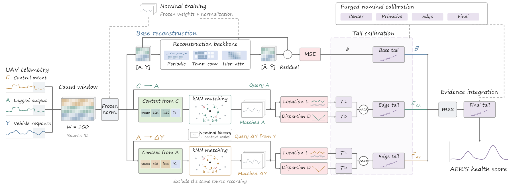

# AERIS

**Control-Context-Aware Fault Monitoring from UAV Flight Telemetry**

AERIS interprets UAV telemetry through the control context that generated it. It combines generic telemetry normality with empirical response distributions along two recorded relations: **control intent → logged actuator output** and **logged actuator output → vehicle-state change**. Matched nominal windows make the reference behavior inspectable; location and two-sided dispersion evidence capture response mismatch, increased variation, and suppressed variation.

This repository provides the AERIS workflow: causal preprocessing, fixed source-recording splits, nominal training and calibration, inference, and evaluation.

<p align="center">
  
</p>

*Fig. 1. The author-supplied AERIS pipeline, reproduced without redrawing. [Vector PDF](docs/assets/aeris_pipeline.pdf).*

## What AERIS does

1. **Preserve the recorded control chain.** Separate control intent `C`, logged actuator output `A`, and vehicle response `Y`. The Base reconstructs `[A,Y]`; it does not read `C`.
2. **Match nominal operating context.** Each relation retrieves exactly 64 nominal windows using driver statistics and the initial response state. The query's source recording is excluded.
3. **Assess a response distribution.** Location energy measures mismatch relative to the matches. Two-sided dispersion identifies both increased and reduced variation. CA aggregates channels by mean; AY uses the median.
4. **Calibrate and integrate.** Nominal-only calibration is staged across primitive, edge-max, and final-max evidence. Maxima retain a strong branch contribution instead of averaging it away.

## Experimental Results

The primary metric is **macro VUS-ROC**: average the five settings within each seed, then report mean ± sample SD over five seeds.

| Method | ALFA: fixed wing | RflyMAD: multirotor |
|---|---:|---:|
| AERIS | 0.925050 ± 0.006550 | 0.665981 ± 0.000622 |
| LSTM-AE | 0.810677 ± 0.005054 | 0.667594 ± 0.002676 |
| Anomaly Transformer | 0.455021 ± 0.018578 | 0.501474 ± 0.014069 |
| iTransformer | 0.570164 ± 0.003296 | 0.565197 ± 0.002678 |
| TimesNet | 0.713566 ± 0.008462 | 0.546717 ± 0.003759 |
| DLinear | 0.626474 ± 0.001400 | 0.562978 ± 0.000121 |
| Conditional LSTM-AE | 0.783821 ± 0.008367 | 0.572327 ± 0.006200 |
| MTCL-UAV | 0.596128 ± 0.022663 | 0.528110 ± 0.008440 |
| Ridge-ARX | 0.733757 | 0.609672 |

Ridge-ARX is deterministic and has no training-seed SD. AERIS has the highest ALFA mean macro VUS-ROC among the evaluated learning methods, a **+0.114373** mean margin over LSTM-AE. On RflyMAD it is competitive with LSTM-AE, with a **−0.001612** macro difference.

### Mechanism increments

Each entry is Full minus its internal control, in macro VUS-ROC.

| Control | ALFA Δ | RflyMAD Δ |
|---|---:|---:|
| Base(A,Y) | +0.068230 | +0.055038 |
| History-only matching | +0.021177 | +0.009106 |
| Pooled nominal reference | +0.003837 | +0.032915 |
| Without dispersion | +0.074124 | +0.010485 |
| Without AY | +0.006640 | −0.002748 |

**Control-context evidence improves monitoring on both UAV platforms.** AERIS raises macro VUS-ROC over the generic Base by **+0.068230 on ALFA** and **+0.055038 on RflyMAD**. Two-sided dispersion contributes **+0.074124** and **+0.010485**, respectively, capturing changes in response variability that location evidence alone misses. Matching nominal references to the recorded control context adds further gains over pooled references on both platforms.

### Onboard execution

The complete AERIS scoring pipeline was executed on a UAV-mounted **Jetson Orin NX in 15 W power mode**, using recorded ALFA STRAT telemetry: **50 Hz input, 10 Hz scoring**, full reference bank and frozen calibration. In a 30-minute replay, all **17,576** valid requests completed; **99.9659%** met a 100 ms deadline, with six late requests, zero drops and zero unfinished requests. Scheduled-request-to-score p50/p99 were **61.46/69.38 ms**; maximum was **215.20 ms**.

## Installation

Use Python 3.10 or newer. The original host used Python 3.13, PyTorch 2.6.0/CUDA 12.4, NumPy 2.4.6 and SciPy 1.17.1. CPU inference and training are supported; a CUDA GPU is recommended for the full training matrix. Install a PyTorch build appropriate for your hardware.

```bash
git clone https://github.com/JunhaoWei-mpu/AERIS.git
cd AERIS
python -m venv .venv
source .venv/bin/activate
python -m pip install --upgrade pip
python -m pip install -e .
python -m pip install pytest
python -m aeris --help
python -m pytest -q
```

The editable install is intentional: configurations and fixed splits are read from this checkout. Plotting packages are not required.

## Data preparation

Download the datasets from their providers; the repository does not redistribute them.

- **ALFA:** [official CMU AirLab dataset page](https://www.cs.cmu.edu/~mmousaei/alfa-dataset/). Use the released processed-flight **CSV** collection.
- **RflyMAD:** [official dataset and tools](https://rfly-openha.github.io/documents/4_resources/dataset.html). Use the real-flight CSV exports under `Real-No_Fault`, `Real-Motor`, and `Real-Sensors`.

```bash
# raw/alfa contains carbonZ_* flight directories, each with its topic CSVs.
python -m aeris prepare --dataset alfa --raw data/raw/alfa --out data/alfa

# raw/rflymad contains the three Real-* directories and their exported topics.
python -m aeris prepare --dataset rflymad --raw data/raw/rflymad --out data/rflymad
```

ALFA preprocessing also creates `data/alfa_before_onset_guard` to preserve the raw-rebuilt version. The final `data/alfa` masks the documented 0.2 s pre-label uncertainty interval while retaining native labels separately. Existing output directories are never overwritten. See [the data schema and channel mapping](docs/DATA.md).

## Reproduce one setting

Reproduce AERIS in three steps: train the Base model on nominal telemetry, build and calibrate the matched nominal references, then evaluate fault-monitoring performance on the fixed test split.

```bash
# 1. Train the reconstruction Base; checkpoint selection uses nominal validation.
python -m aeris train --dataset alfa --setting strat --seed 0 \
  --data-root data/alfa --out runs/alfa/strat/seed0 --device cuda:0

# 2. Build the complete nominal library and fit all nominal calibration stages.
python -m aeris fit-reference --dataset alfa --setting strat \
  --data-root data/alfa --out runs/alfa/strat/seed0 --device cuda:0

# 3. Evaluate on the fixed test partition and common causal support.
python -m aeris evaluate --dataset alfa --setting strat \
  --data-root data/alfa --out runs/alfa/strat/seed0 --device cuda:0
```

Use `--device cpu` for a CPU run. Outputs are local: `base.pth`, `monitor.pth`, checkpoint/fit provenance, per-record score files and `evaluation/metrics.json`. They are ignored by Git. Insufficient nominal tail support is a calibration failure; the code does not silently change the percentile, tail family or membership.

## Reproduce the five-seed AERIS evaluation

```bash
# Five ALFA settings × seeds 0–4.
python -m aeris reproduce --dataset alfa --data-root data/alfa \
  --seeds 0 1 2 3 4 --device cuda:0 --out runs

# Five RflyMAD settings × seeds 0–4; fit on target nominal telemetry.
python -m aeris reproduce --dataset rflymad --data-root data/rflymad \
  --seeds 0 1 2 3 4 --device cuda:0 --out runs
```

`--setting strat` restricts a campaign to one setting. Each invocation uses a new output directory and never chooses a best seed. The evaluation also produces history-only, pooled-reference, no-dispersion and no-AY controls. This release implements AERIS and its internal controls; the external methods in the manuscript table are not silently replaced by approximate implementations here.

## Score your own complete windows

After fitting a monitor, save an NPZ with:

- `windows`: `(N,100,D)` float32, **raw physical units**, causal and finite. `D=22` on ALFA, `D=16` on RflyMAD. Do not normalize these inputs a second time.
- `source_groups`: `(N,)` strings containing original source-recording identities, consistent with the fitted library. Do not collapse different recordings into a shared dummy ID.

```bash
python -m aeris score --bundle runs/alfa/strat/seed0/monitor.pth \
  --input my_windows.npz --output local_scores.npz --device cpu
```

The API is also available directly:

```python
from aeris import FrozenHorizonAERIS

monitor = FrozenHorizonAERIS.load("runs/alfa/strat/seed0/monitor.pth", "cpu")
# windows and source_groups follow the schema above.
scores = monitor.score_windows(windows, source_groups, batch_size=128)
# scores["score"], scores["base_raw"], scores["ca_evidence"], scores["ay_evidence"]
```

The window API does not resample streams or invent missing input. Its caller must retain timestamps, continuity and availability. It returns continuous health evidence, not a calibrated fault probability or a tested alarm decision. Load only checkpoints from a trusted source.

## Fixed protocol

| Item | Setting |
|---|---|
| Input window | 100 samples: ALFA 50 Hz; RflyMAD 20 Hz |
| Response increment/averaging horizon | 0.4 s: 20 / 8 samples |
| Nominal library | Complete deduplicated, nonoverlapping training windows |
| Matching | Exact squared-Euclidean kNN, k=64, query-source exclusion |
| Context | Driver mean, population SD and penultimate value; encoded initial response state |
| Circular channels | ALFA degrees; RflyMAD radians; shortest signed differences |
| Channel aggregation | CA mean; AY median |
| Tail calibration | Empirical body; fixed nominal 95% exponential extension; ≥20 strictly positive excesses |
| Fusion | Calibrated primitive maxima → edge calibration → Base/CA/AY maximum → final calibration |
| Benchmark support | 199 contiguous samples; distinct from the 100-sample model input |
| Metric | VUS-ROC / VUS-PR, 250 thresholds, integer tolerance widths 0–100; point AUROC/AUPR |
| Model selection | Nominal-validation objective; 12-epoch Base recipe |

The settings, physical semantics and source-separated splits are provided under `configs/` and `splits/`. [Method details](docs/METHOD.md) explain the equations and calibration roles.

## Repository map

```text
aeris/             Portable prepare/train/fit/score/evaluate workflow
src/               Frozen numerical model, data, training-loss and metric modules
configs/           Fixed Base recipe and monitoring settings
splits/            Ten source-separated dataset/setting definitions
scripts/           Existing causal CSV adapter and clean-target training helper
tests/             Circular-response, tail, source-exclusion and protocol checks
docs/              Data/method documentation and the unchanged Fig. 1 artwork
provenance/        Source-code identities; no experiment output archive
```

## Citation and license

The companion manuscript is **AERIS: Control-Context-Aware Fault Monitoring from UAV Flight Telemetry**. This repository does not assert an accepted publication or invent a DOI. Until a publication identifier is available, cite the software repository:

```bibtex
@software{aeris_uav_2026,
  author = {Wei, Junhao and others},
  title = {AERIS: Control-Context-Aware Fault Monitoring from UAV Flight Telemetry},
  year = {2026},
  url = {https://github.com/JunhaoWei-mpu/AERIS}
}
```

Released under the [MIT License](LICENSE). See [acknowledgments and third-party references](docs/ACKNOWLEDGMENTS.md).
